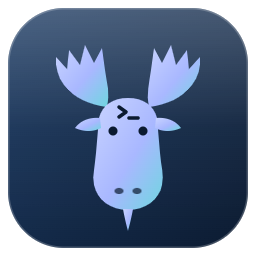
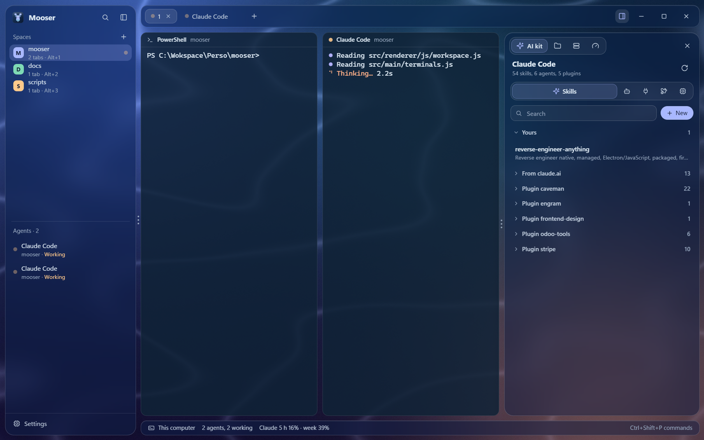
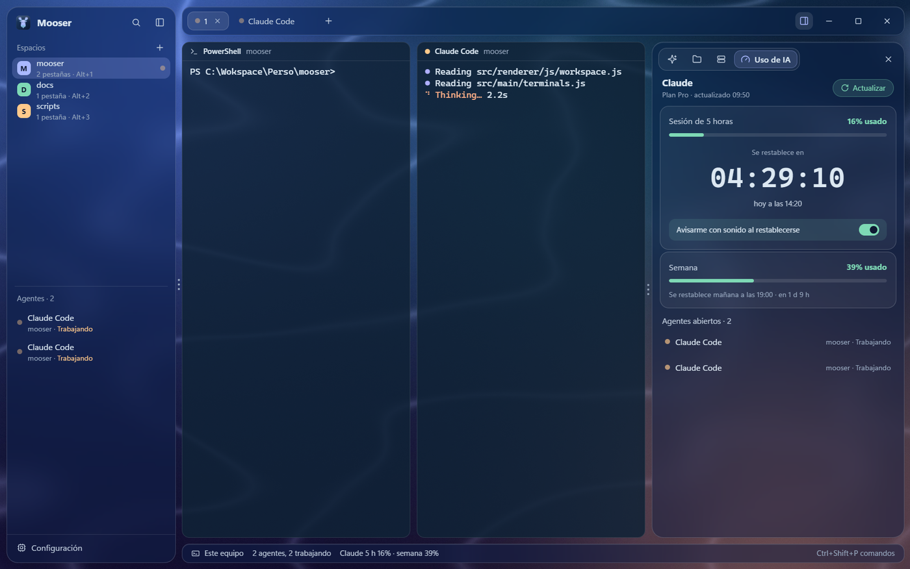
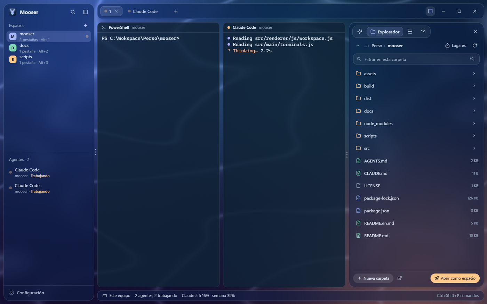
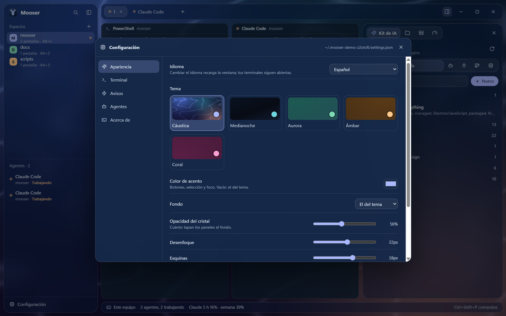
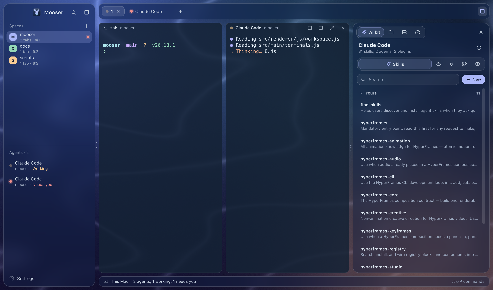
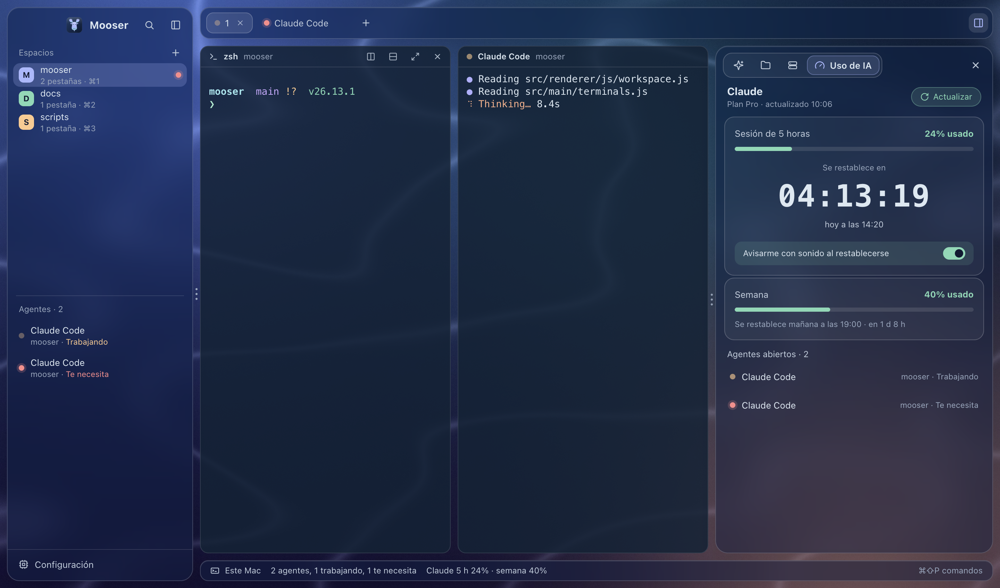
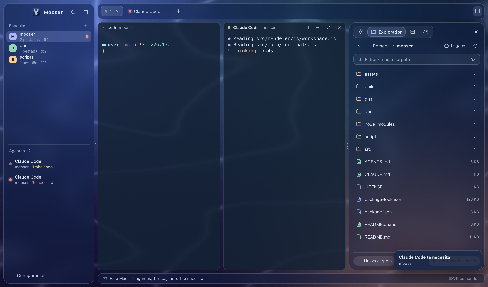
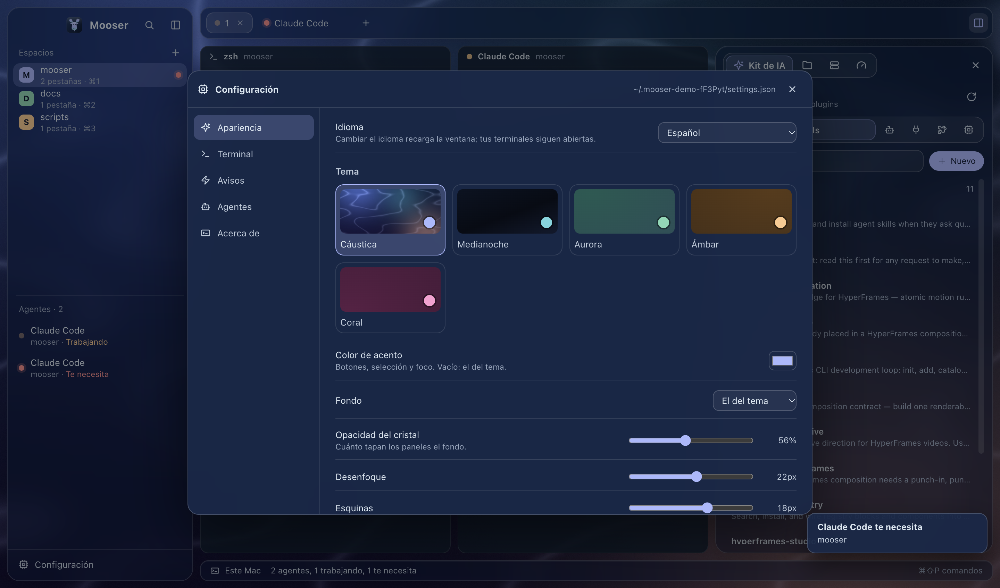

<p align="center">
  
</p>

<h1 align="center">Mooser</h1>

<p align="center">
  <b>A calm home for your terminals and AI agents.</b><br>
  Spaces per project, tabs, split panes, every agent's status,<br>
  and panels for your skills, files, SSH servers and Claude plan usage.
</p>

<p align="center">
  Windows · macOS (Apple Silicon and Intel) · English / Español · MIT license
</p>

<p align="center"><a href="README.md">Leer en español</a></p>

<p align="center">
  
</p>

---

## What it is

Mooser is a desktop app for working with several coding agents at once (Claude Code, Codex, Gemini CLI, Aider, OpenCode…) without getting lost among terminal windows. Each project is a space with its own tabs and panes. Mooser recognizes the agents running in them, shows which one is working, which one needs you and which one finished, and alerts you when you're doing something else.

## Features

**Workspace**
- **Spaces**: each project folder is a space; switch with a click or `Alt+1…9` (`⌘1…9` on a Mac).
- **Tabs and panes**: split any pane right or down, resize by dragging the three dots, zoom one with a shortcut.
- **Saved session**: your spaces, tabs and splits are saved; when you come back, each terminal starts again in its folder.
- **Command palette**: everything from the keyboard (`Ctrl+Shift+P` / `⌘⇧P`).

**Agents**
- Recognizes Claude Code, Codex, Gemini CLI, Aider, OpenCode, Cursor Agent, Copilot CLI, Amp, Goose, Qwen Code and Kiro.
- Status: **working**, **needs you** (asking you something) and **done** (while you were looking elsewhere).
- Alerts with a soft sound and a system notification.
- The **+** button opens a terminal or starts the agent you pick.

**Side panel**
- **AI kit**: Claude Code's skills, agents, MCP servers, plugins and default model. Create and edit your skills and agents, turn plugins on or off, add or remove MCP servers, pick the model.
- **Explorer**: browse folders, open files, open a folder as a space, create, rename, move, copy or trash. Icons are colored by file type.
- **Servers**: save your SSH servers in colored groups, connect in a tab with the saved (encrypted) password, and move files between your computer and your servers, or server to server.
- **AI usage**: how much of your Claude plan's 5-hour session and week you've used, with a countdown to the reset and an optional alert.

**Make it yours**
- Five themes (Caustic, Midnight, Aurora, Amber and Coral), accent color, your own background, glass, sizes and animations.
- English and Spanish.

## Screenshots

### Windows

<table>
  <tr>
    <td></td>
    <td></td>
  </tr>
  <tr>
    <td align="center">Spaces, panes and agents with their status</td>
    <td align="center">Your Claude plan usage</td>
  </tr>
  <tr>
    <td></td>
    <td></td>
  </tr>
  <tr>
    <td align="center">Explorer</td>
    <td align="center">Settings: themes, terminal, alerts</td>
  </tr>
</table>

### macOS

<table>
  <tr>
    <td></td>
    <td></td>
  </tr>
  <tr>
    <td align="center">Spaces, panes and agents with their status</td>
    <td align="center">Your Claude plan usage</td>
  </tr>
  <tr>
    <td></td>
    <td></td>
  </tr>
  <tr>
    <td align="center">Explorer</td>
    <td align="center">Settings: themes, terminal, alerts</td>
  </tr>
</table>

## Download and install

Get the installer for your system from **[Releases](../../releases)**:

| System | File |
|---|---|
| Windows 10 or 11 (64-bit) | `Mooser-Setup-x.y.z-x64.exe` |
| macOS on Apple Silicon (M1, M2, M3, M4…) | `Mooser-x.y.z-mac-arm64.dmg` |
| macOS on Intel | `Mooser-x.y.z-mac-x64.dmg` |

- **Windows**: run the installer, pick the language and folder. If SmartScreen warns, choose **More info**, then **Run anyway** (the installer isn't signed yet).
- **macOS**: open the `.dmg` and drag Mooser to **Applications**. The first time, macOS says it *could not verify that Mooser is free of malware*. That's expected for an app Apple hasn't notarized yet:
  1. In that dialog, click **Done**, not "Move to Trash".
  2. Open **System Settings → Privacy & Security**, scroll to *Security* and click **Open Anyway** next to "Mooser was blocked". Confirm with your password (on macOS 14 or earlier, right-click and **Open** is enough).
  3. From then on it opens normally.

  Or, in one go, in Terminal:
  ```sh
  xattr -dr com.apple.quarantine /Applications/Mooser.app
  ```

From source (Node.js 20+ and Git):

```sh
git clone https://github.com/davechbga/mooser.git
cd mooser
npm install
npm start
```

Optional: [Claude Code](https://docs.claude.com/claude-code) for the AI kit and usage; [Git for Windows](https://git-scm.com/download/win) so saved server passwords are typed for you on Windows; VS Code to edit skills and agents.

## Shortcuts

| Action | Windows | macOS |
|---|---|---|
| Command palette | `Ctrl+Shift+P` | `⌘⇧P` |
| Settings | `Ctrl+,` | `⌘,` |
| New space | `Ctrl+Shift+N` | `⌘⇧N` |
| New tab | `Ctrl+Shift+T` | `⌘T` |
| Split right / down | `Ctrl+Shift+D` / `Ctrl+Shift+E` | `⌘D` / `⌘⇧D` |
| Close pane | `Ctrl+Shift+W` | `⌘W` |
| Zoom pane | `Ctrl+Shift+Z` | `⌘⇧Enter` |
| Side panel | `Ctrl+Shift+J` | `⌘J` |
| Fold sidebar | `Ctrl+Shift+B` | `⌘B` |
| Go to space 1…9 | `Alt+1…9` | `⌘1…9` |
| Next / previous tab | `Ctrl+Tab` / `Ctrl+Shift+Tab` | `⌘⇧]` / `⌘⇧[` (or `Ctrl+Tab`) |
| Move between panes | `Alt+arrows` | `⌘⌥+arrows` |
| Copy / paste | `Ctrl+Shift+C` / `Ctrl+Shift+V` | `⌘C` / `⌘V` |

## Settings and language

**Settings** (bottom of the sidebar, or `Ctrl+,` / `⌘,`): language, theme, accent, background, glass, sizes, animations, terminal font and shell, alerts, and the agents in the **+** menu. Everything is saved in `~/.mooser/settings.json`, which you can also edit by hand; your own styles (`custom.css`) and plugins (`plugins/`) live in the same folder, documented in its `AGENTS.md`. Mooser follows your system language by default.

## Privacy and security

- Server passwords are stored only encrypted with the system's secure storage (DPAPI on Windows, the Keychain on macOS) and handed to ssh over a local one-time channel.
- Claude usage reads the session Claude Code already keeps and sends it only to `api.anthropic.com`; it is never stored or refreshed.
- No telemetry.

## Development

```sh
npm install
npm run dev     # with DevTools; saving a file in src/renderer reloads the window
```

The code layout and the rules for changing it are in [AGENTS.md](AGENTS.md); building the Windows and macOS installers, in [docs/BUILD.md](docs/BUILD.md).

## License

[MIT](LICENSE).
