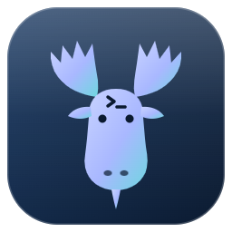
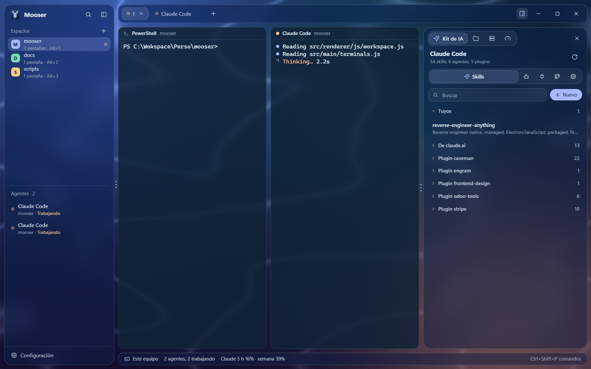
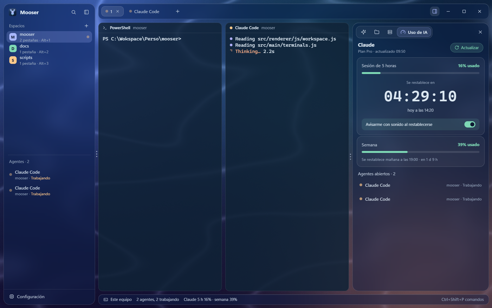
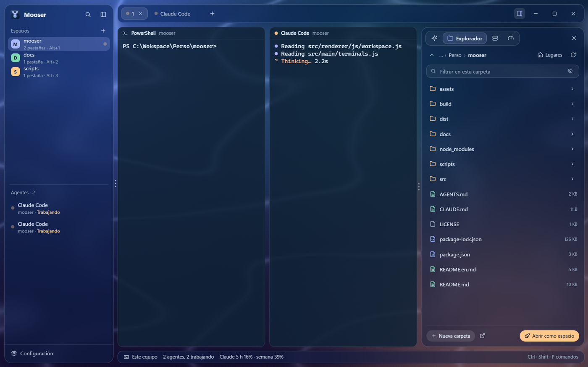
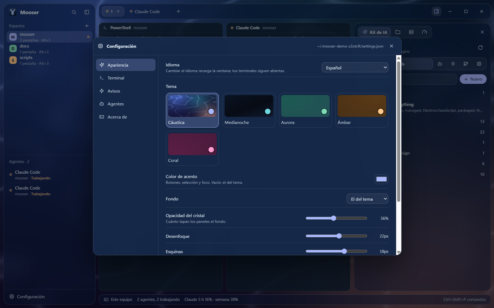
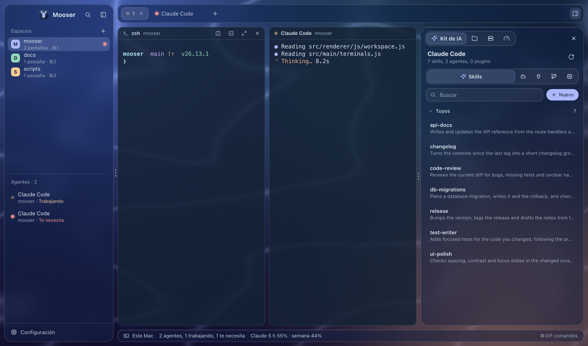
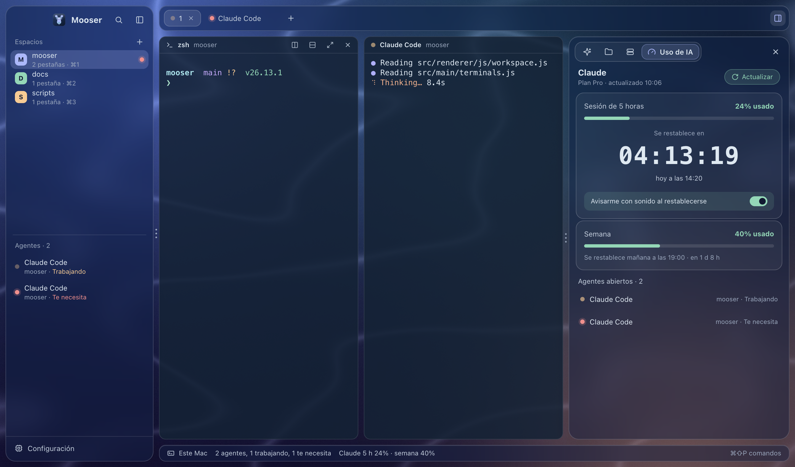
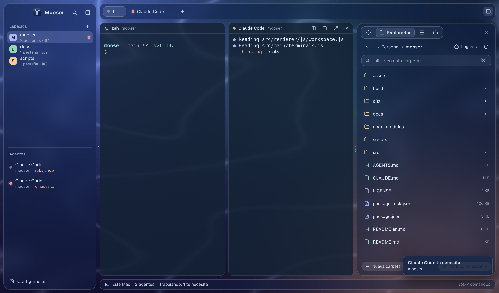
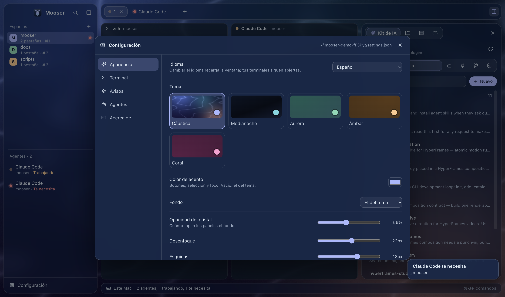

<p align="center">
  
</p>

<h1 align="center">Mooser</h1>

<p align="center">
  <b>Un hogar tranquilo para tus terminales y tus agentes de IA.</b><br>
  Espacios por proyecto, pestañas, paneles divididos, el estado de cada agente<br>
  y paneles para tus skills, archivos, servidores SSH y el uso de tu plan de Claude.
</p>

<p align="center">
  Windows · macOS (Apple Silicon e Intel) · Español / English · Licencia MIT
</p>

<p align="center"><a href="README.en.md">Read in English</a></p>

<p align="center">
  
</p>

---

## Índice

- [Qué es](#qué-es)
- [Funciones](#funciones)
- [Capturas](#capturas)
- [Descargar e instalar](#descargar-e-instalar)
- [Primeros pasos](#primeros-pasos)
- [Atajos de teclado](#atajos-de-teclado)
- [Configuración](#configuración)
- [Idioma](#idioma)
- [Privacidad y seguridad](#privacidad-y-seguridad)
- [Desarrollo](#desarrollo)
- [Preguntas frecuentes](#preguntas-frecuentes)
- [Licencia](#licencia)

## Qué es

Mooser es una app de escritorio para trabajar con varios agentes de código a la vez, como Claude Code, Codex, Gemini CLI, Aider u OpenCode, sin perderte entre ventanas de terminal. Cada proyecto es un espacio con sus pestañas y paneles. Mooser reconoce a los agentes que corren en ellos, te dice cuál está trabajando, cuál te necesita y cuál terminó, y te avisa cuando estás en otra cosa.

## Funciones

**Espacio de trabajo**
- **Espacios**: cada carpeta de proyecto es un espacio. Cambias entre ellos con un clic o con `Alt+1…9` (`⌘1…9` en Mac).
- **Pestañas y paneles**: divide cualquier panel a la derecha o hacia abajo, cambia el tamaño arrastrando los tres puntos y amplía uno con un atajo.
- **Sesión guardada**: al cerrar se guardan tus espacios, pestañas y divisiones; al volver, cada terminal empieza de nuevo en su carpeta.
- **Paleta de comandos**: todo con el teclado (`Ctrl+Shift+P` / `⌘⇧P`).

**Agentes**
- Reconoce Claude Code, Codex, Gemini CLI, Aider, OpenCode, Cursor Agent, Copilot CLI, Amp, Goose, Qwen Code y Kiro.
- Estados: **trabajando**, **te necesita** (te hace una pregunta) y **terminó** (mientras mirabas otra cosa).
- Avisos con un sonido suave y una notificación del sistema.
- El botón **+** abre una terminal o arranca directamente el agente que elijas.

**Panel lateral**
- **Kit de IA**: los skills, agentes, servidores MCP, plugins y el modelo por defecto de Claude Code. Crea y edita tus skills y agentes, enciende o apaga plugins, añade o quita servidores MCP y elige el modelo.
- **Explorador**: navega carpetas, abre archivos, abre una carpeta como espacio, crea, renombra, mueve, copia o envía a la papelera. Los iconos tienen color según el tipo de archivo.
- **Servidores**: guarda tus servidores SSH en grupos de color, conéctate en una pestaña con la contraseña guardada (cifrada) y pasa archivos entre tu equipo y tus servidores, o de un servidor a otro.
- **Uso de IA**: cuánto llevas de la sesión de 5 horas y de la semana de tu plan de Claude, con una cuenta atrás hasta que se restablece y un aviso opcional.

**A tu gusto**
- Cinco temas (Cáustica, Medianoche, Aurora, Ámbar y Coral), color de acento, fondo propio, cristal, tamaños y animaciones.
- Español e inglés.

## Capturas

### Windows

<table>
  <tr>
    <td></td>
    <td></td>
  </tr>
  <tr>
    <td align="center">Espacios, paneles y agentes con su estado</td>
    <td align="center">Uso de tu plan de Claude</td>
  </tr>
  <tr>
    <td></td>
    <td></td>
  </tr>
  <tr>
    <td align="center">Explorador</td>
    <td align="center">Configuración: temas, terminal, avisos</td>
  </tr>
</table>

### macOS

<table>
  <tr>
    <td></td>
    <td></td>
  </tr>
  <tr>
    <td align="center">Espacios, paneles y agentes con su estado</td>
    <td align="center">Uso de tu plan de Claude</td>
  </tr>
  <tr>
    <td></td>
    <td></td>
  </tr>
  <tr>
    <td align="center">Explorador</td>
    <td align="center">Configuración: temas, terminal, avisos</td>
  </tr>
</table>

## Descargar e instalar

### Con el instalador

Descarga el de tu sistema en la página de **[Releases](../../releases)**:

| Sistema | Archivo |
|---|---|
| Windows 10 u 11 (64 bits) | `Mooser-Setup-x.y.z-x64.exe` |
| macOS con Apple Silicon (M1, M2, M3, M4…) | `Mooser-x.y.z-mac-arm64.dmg` |
| macOS con Intel | `Mooser-x.y.z-mac-x64.dmg` |

- **Windows**: abre el instalador, elige el idioma y la carpeta, y listo. Si Windows SmartScreen avisa, pulsa **Más información** y luego **Ejecutar de todas formas** (el instalador aún no está firmado).
- **macOS**: abre el `.dmg` y arrastra Mooser a **Aplicaciones**. La primera vez, macOS dirá que *no ha podido verificar que Mooser no contiene software malicioso*. Es normal en una app que aún no está notarizada por Apple:
  1. En ese aviso pulsa **Listo**, no "Trasladar a la papelera".
  2. Abre **Ajustes del Sistema → Privacidad y seguridad**, baja hasta *Seguridad* y pulsa **Abrir igualmente** junto a "Se bloqueó el uso de Mooser". Confirma con tu contraseña (en macOS 14 o anterior basta con clic derecho y **Abrir**).
  3. Desde entonces se abre normalmente.

  O, de una vez, en la Terminal:
  ```sh
  xattr -dr com.apple.quarantine /Applications/Mooser.app
  ```

### Desde el código

Necesitas [Node.js](https://nodejs.org) 20 o más reciente y Git.

```sh
git clone https://github.com/davechbga/mooser.git
cd mooser
npm install
npm start
```

### Requisitos opcionales

| Para | Necesitas |
|---|---|
| Kit de IA | [Claude Code](https://docs.claude.com/claude-code) instalado |
| Uso de IA | Haber iniciado sesión en Claude Code en este equipo |
| Contraseñas de servidores guardadas, en Windows | [Git for Windows](https://git-scm.com/download/win) (su `ssh` acepta la contraseña sin teclearla). Sin él, ssh te la pide en la terminal |
| Editar skills y agentes | VS Code (`code`) o el editor por defecto del sistema |

## Primeros pasos

1. Pulsa **Abrir carpeta** y elige un proyecto: se crea un espacio con una terminal en esa carpeta.
2. Pulsa **+** en la barra de pestañas para abrir otra terminal o arrancar un agente.
3. Divide paneles desde su cabecera o con los atajos. Arrastra los tres puntos entre paneles para cambiar el tamaño.
4. Abre el panel lateral (el botón a la derecha de la barra de pestañas) para el Kit de IA, el Explorador, los Servidores o el Uso de IA.
5. Pliega la barra lateral con su botón o arrastrando su borde: queda una columna de iconos con el estado de cada espacio y agente.

## Atajos de teclado

| Acción | Windows | macOS |
|---|---|---|
| Paleta de comandos | `Ctrl+Shift+P` | `⌘⇧P` |
| Configuración | `Ctrl+,` | `⌘,` |
| Nuevo espacio | `Ctrl+Shift+N` | `⌘⇧N` |
| Nueva pestaña | `Ctrl+Shift+T` | `⌘T` |
| Dividir a la derecha | `Ctrl+Shift+D` | `⌘D` |
| Dividir hacia abajo | `Ctrl+Shift+E` | `⌘⇧D` |
| Cerrar panel | `Ctrl+Shift+W` | `⌘W` |
| Ampliar panel | `Ctrl+Shift+Z` | `⌘⇧Enter` |
| Panel lateral | `Ctrl+Shift+J` | `⌘J` |
| Plegar barra lateral | `Ctrl+Shift+B` | `⌘B` |
| Ir al espacio 1…9 | `Alt+1…9` | `⌘1…9` |
| Pestaña siguiente / anterior | `Ctrl+Tab` / `Ctrl+Shift+Tab` | `⌘⇧]` / `⌘⇧[` (o `Ctrl+Tab`) |
| Moverse entre paneles | `Alt+flechas` | `⌘⌥+flechas` |
| Copiar / pegar | `Ctrl+Shift+C` / `Ctrl+Shift+V` | `⌘C` / `⌘V` |
| Texto más grande / pequeño | `Ctrl+=` / `Ctrl+-` | `⌘+` / `⌘-` |

`Ctrl` sin `Shift` llega siempre al programa de la terminal (Ctrl+C, Ctrl+R…).

## Configuración

Pulsa **Configuración** abajo en la barra lateral (o `Ctrl+,` / `⌘,`):

- **Apariencia**: idioma, tema, color de acento, fondo (el del tema, un color liso o tu imagen), opacidad y desenfoque del cristal, esquinas, separación, tamaño del texto y animaciones.
- **Terminal**: fuente, tamaño, interlineado, cursor, historial, shell y copiar al seleccionar.
- **Avisos**: sonido, notificaciones del sistema y el aviso de restablecimiento de Claude.
- **Agentes**: los que aparecen en el botón **+**, con su comando.

Todo se guarda en `~/.mooser/settings.json` (en Windows, `C:\Users\<tú>\.mooser\settings.json`), un archivo que también puedes editar a mano. En esa carpeta también puedes poner tus propios estilos (`custom.css`) y plugins (`plugins/`); cómo funcionan está en su `AGENTS.md`. Los cambios se aplican al guardar.

## Idioma

Mooser está en español e inglés. Por defecto usa el idioma de tu sistema; puedes cambiarlo en **Configuración, Apariencia, Idioma**. El instalador de Windows también te deja elegir su idioma.

## Privacidad y seguridad

- **Contraseñas de servidores**: se guardan solo cifradas con el almacén seguro del sistema (DPAPI en Windows, el Llavero en macOS). Cuando ssh pide la contraseña, un pequeño ayudante se la pide a Mooser por un canal local con un código de un solo uso; nunca queda en un archivo ni en una variable de entorno en claro.
- **Uso de Claude**: Mooser lee la sesión que Claude Code ya guarda en tu equipo y la envía solo a `api.anthropic.com` para consultar tu uso. No la guarda ni la renueva.
- **Kit de IA**: cambia solo la configuración de Claude Code en `~/.claude`, o lo hace a través de su propia CLI.
- **Plugins**: son tu propio código y se ejecutan con los permisos de la app.
- **Sin telemetría**: Mooser no envía nada a ningún otro sitio.

## Desarrollo

```sh
npm install
npm run dev     # con DevTools; al guardar algo en src/renderer la ventana se recarga
```

La estructura del código y las reglas para cambiarlo están en [AGENTS.md](AGENTS.md); cómo crear los instaladores de Windows y macOS, en [docs/BUILD.md](docs/BUILD.md).

## Preguntas frecuentes

**¿Mis terminales siguen vivas si cierro Mooser?** No: viven mientras la app está abierta. Al volver a abrirla, cada pestaña empieza de nuevo en su carpeta.

**¿Funciona sin Claude Code?** Sí. Las terminales, espacios, agentes, Explorador y Servidores funcionan igual; el Kit de IA y el Uso de IA necesitan Claude Code.

**¿Qué agentes reconoce?** Los que se lanzan desde la terminal y se identifican por su nombre o por el título que ponen: Claude Code, Codex, Gemini CLI, Aider, OpenCode, Cursor Agent, Copilot CLI, Amp, Goose, Qwen Code y Kiro.

**Mi shell no es PowerShell / zsh.** Elige otra en **Configuración, Terminal, Shell** (por ejemplo `bash` o la ruta completa al programa).

## Licencia

[MIT](LICENSE). Mooser está escrito desde cero e inspirado en la idea de los multiplexores de agentes; no usa código de otros proyectos de ese tipo.
